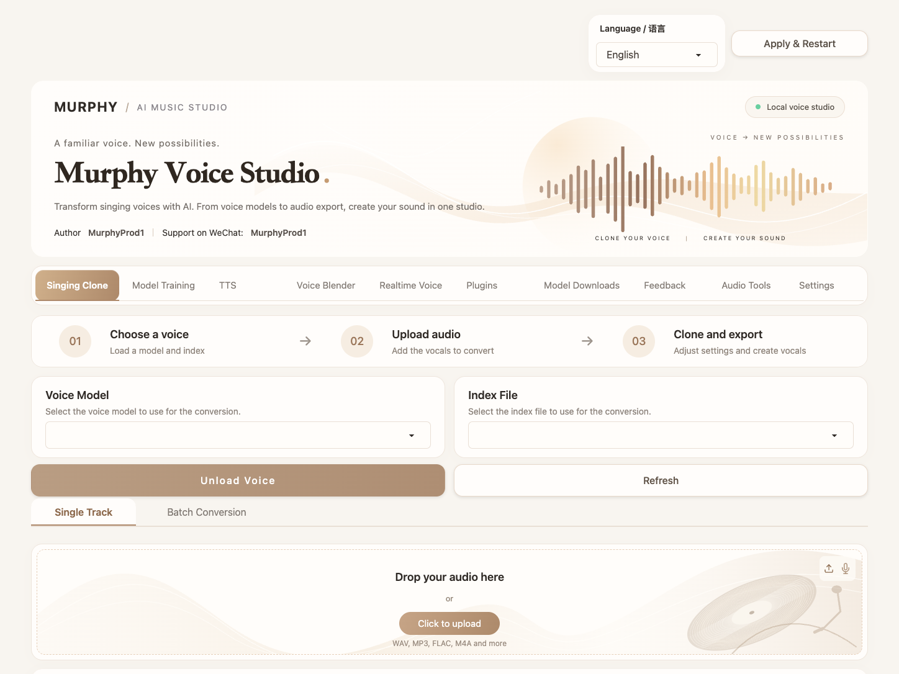

# Murphy Voice Studio · AI唱歌克隆

A local AI singing and voice studio with a warm ivory interface. Voice conversion, model training, TTS, voice blending, realtime voice changing and audio tools — with English and Chinese interfaces.

米白暖金风格的本地 AI 歌声与声音工作台，支持歌声转换、模型训练、TTS、声音融合、实时变声和音频工具，可选择英文或中文界面。

**Author / 作者：MurphyProd1 · Support on WeChat / 有问题联系微信：MurphyProd1**



[English](#english) · [中文](#中文)

## English

### Features

- Single track and batch voice conversion, voice models and audio export.
- Model training, TTS, voice blending, realtime voice changing and audio tools.
- Warm ivory design for desktop and mobile browsers.
- Select **English** or **简体中文** at the top, then click **Apply & Restart**. The studio remembers your choice and reloads the interface after restarting.

### Setup

Prepare Python, FFmpeg and platform-specific dependencies following the [upstream setup guide](app/README.md).

```bash
git clone https://github.com/xudongdai-ai/murphy-voice-studio.git
cd murphy-voice-studio/app
# Use a Python environment configured for your platform.
python -m pip install -r requirements.txt
python app.py --open
```

Default URL: `http://127.0.0.1:6969`. Put your `.pth` and `.index` models in `app/logs/<model-name>/`. The first launch downloads the required base models.

On macOS, after configuring `app/env`, `app/.venv` or the root `.venv`, use `start.command`; `AI_CLONE_PYTHON` can specify another Python executable. Run `./desktop/build.command` to build `build/Murphy Voice Studio.app`; the launcher requires an existing installation at `~/pinokio/api/applio.git/app`. See [macOS launcher sources](desktop/README.md).

Verified locally on macOS Apple Silicon with Python 3.10.15, Gradio 5.23.1 and PyTorch 2.7.1. The upstream installer targets Python 3.12. `environment-macos-python310.txt` records the local environment; it is not a cross-platform lockfile. A clean installation on another machine, Gradio 6, full training and voice conversion have not been reverified for this customization.

### Source

`app/` contains application code; `app/assets/brand.py`, `brand.css` and `themes/AISinging.py` define the custom interface. `preview/` contains screenshots captured from an isolated source preview with no personal models or audio.

Python environments, voice models, index files, private audio and training data are excluded. Bundled upstream reference fixtures are included. See [packaging and privacy checks](PRIVACY.md).

### License

Developed as a customization of [Applio](https://github.com/IAHispano/Applio). [MIT License](LICENSE).

## 中文

### 功能

- 单曲及批量歌声转换、声音模型选择与音频导出。
- 模型训练、TTS、声音融合、实时变声和音频工具。
- 米白暖金界面，适配桌面与手机浏览器。
- 在首页顶部选择 **English** 或 **简体中文**，点击 **应用并重启**；软件会记住选择，重启后自动刷新界面。


### 启动

先按[原项目安装说明](app/README.md)配置 Python、FFmpeg 和对应平台的依赖，再执行上面的启动命令。网页默认地址为 `http://127.0.0.1:6969`。模型放到 `app/logs/<模型名>/`，首次启动会下载所需基础模型。

macOS 配好 `app/env`、`app/.venv` 或根目录 `.venv` 后，可双击 `start.command`；也可通过 `AI_CLONE_PYTHON` 指定 Python 路径。运行 `./desktop/build.command` 可生成 `build/Murphy Voice Studio.app`；启动器依赖 `~/pinokio/api/applio.git/app` 的已有安装，见[启动器源码说明](desktop/README.md)。

本机验证环境为 macOS Apple Silicon、Python 3.10.15、Gradio 5.23.1、PyTorch 2.7.1。原始安装脚本默认 Python 3.12，环境快照仅供迁移参考。新机器安装、Gradio 6、完整训练和歌声转换流程未在本次定制中重新验证。

源码不含 Python 环境、声音模型、索引、私人音频与训练数据，保留原项目随源码提供的参考素材。预览截图使用没有私人模型和音频的隔离环境，见[打包与隐私检查](PRIVACY.md)。

### 开源说明

基于 [Applio](https://github.com/IAHispano/Applio) 二次开发。[MIT 许可证](LICENSE)。
