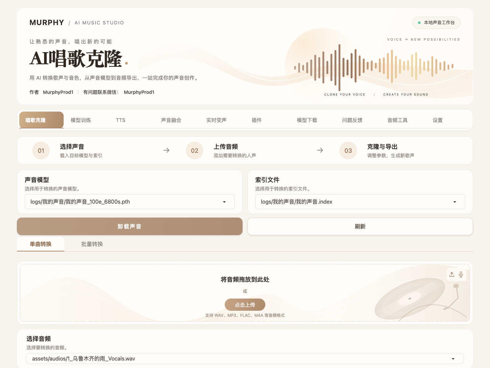

# Murphy Voice Studio · AI唱歌克隆

米白暖金风格的本地 AI 声音工作台，基于 [Applio](https://github.com/IAHispano/Applio) 定制。提供歌声音色转换、声音模型训练、TTS、声音融合、实时变声和音频工具。

**界面定制：MurphyProd1 · 有问题联系微信：MurphyProd1**



## 功能与界面

- 中文米白音乐工作台：声波首页、模型与索引卡片、唱片上传区域。
- 单曲与批量转换：选择模型、上传音频、调整参数并导出歌声。
- 模型训练、TTS、声音融合、实时变声、模型下载及音频工具。
- 适配桌面和手机浏览器，保留原项目的实际后端功能。

截图来自本机实际运行页面。界面、导航、模型刷新和音频上传已验证；本次未重新验证完整训练和歌声转换流程。

## 启动

本仓库是源码，需自行准备 Python 环境、FFmpeg 和模型。请按 [原项目说明](app/README.md) 与安装脚本配置对应平台的依赖。

```bash
git clone https://github.com/xudongdai-ai/murphy-voice-studio.git
cd murphy-voice-studio/app
# 配好对应平台的 Python 环境后：
python -m pip install -r requirements.txt
python app.py --open
```

默认网页地址为 `http://127.0.0.1:6969`。首次运行会按原项目逻辑下载基础模型，需要网络和可用磁盘空间。将自己的 `.pth` 和 `.index` 文件放到 `app/logs/<模型名>/`，在网页选择后使用。

macOS 配好 `app/env`、`app/.venv` 或根目录 `.venv` 后，可双击 `start.command`；也可通过 `AI_CLONE_PYTHON` 指定 Python 路径。

原始安装脚本默认 Python 3.12；本次已运行环境为 macOS Apple Silicon、Python 3.10.15、Gradio 5.23.1、PyTorch 2.7.1。`environment-macos-python310.txt` 是本机环境快照，包含传递依赖，供迁移参考，不是跨平台锁文件。全新机器安装和 Gradio 6 尚未实机验证。

## 项目目录

| 路径 | 内容 |
| --- | --- |
| `app/` | 应用源码与原项目文档 |
| `app/assets/brand.py` | 名称、首页、作者、联系方式 |
| `app/assets/brand.css` | 定制界面样式 |
| `app/assets/themes/AISinging.py` | 米白暖金主题 |
| `app/assets/ui/upload-art.svg` | 上传区域矢量装饰 |
| `preview/` | 实际运行截图与验证记录 |
| `start.command` | macOS 源码启动脚本 |
| `desktop/` | macOS 桌面启动器备份 |

`desktop/ai唱歌克隆.app` 依赖 `~/pinokio/api/applio.git/app` 的已有安装；它不是自带 Python 和模型的独立安装包。迁移时优先使用源码和 `start.command`。

仓库不包含 Python 环境、下载模型、用户训练权重、私人音频或生成音频。原项目随源码提供的静音和参考测试素材保留。实时设备和历史模型配置已清空，默认关闭 Discord 状态显示。

## 更多预览

[完整桌面界面](preview/ai唱歌克隆-前端预览.png) · [手机界面](preview/ai唱歌克隆-手机.png) · [验证说明](preview/验证说明.md)

## 开源来源

本项目基于 Applio（AI Hispano）的 MIT 授权源码进行界面定制。原始版权及许可全文保存在 [LICENSE](LICENSE) 和 [app/LICENSE](app/LICENSE)，原始使用条款保存在 [app/TERMS_OF_USE.md](app/TERMS_OF_USE.md)。MurphyProd1 为本次界面定制版的作者与联系方式。
